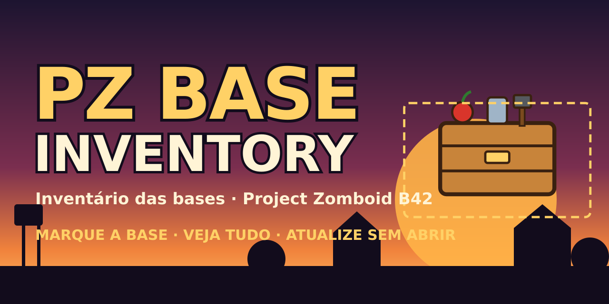

<p align="center"></p>

# PZ Base Inventory — todos os seus itens, dentro da base

**Versão:** 0.2.18 · **Mod ID:** `PZBaseInventory` · **Build:** 42 · **Escopo:** single player (multijogador planejado)
**Workshop:** a definir · **Licença:** a definir · **Documentação:** [TESTES.md](TESTES.md) · [ESPECIFICACAO.md](ESPECIFICACAO.md)

Você montou a base perfeita: cerca dupla, plantação, gerador e comida para dois apocalipses.
Só que os itens estão espalhados em vinte caixas, e você não lembra em qual está o martelo.

**PZ Base Inventory** marca a área da sua base no chão, lê os contêineres que estão dentro dela
e mostra tudo num painel só: por categoria, com quantidade, peso e localização. Sem abrir um por um.

> **Estado do projeto:** em desenvolvimento. Parte das funcionalidades já foi validada em jogo e parte
> ainda não. A coluna **Status** da tabela abaixo mostra o que é o quê.

---

## O que faz

| Recurso | Como funciona | Status |
|---|---|---|
| 🗺️ **Marcar a base** | Botão direito no chão → *PZBase → Criar área*. Arraste sobre o chão e dê um nome à cidade | Validado em jogo |
| 👁️ **Ver áreas** | Destaca as bases no chão e mostra um resumo | Não testado |
| 🗑️ **Apagar base** | Clique numa área sua e confirme | Validado em jogo |
| 📦 **Ler contêineres** | Ao fechar a janela de um contêiner dentro de base, o estado dele é registrado | Validado em jogo |
| 🧭 **Só dentro da base** | Móveis fora de base não são lidos, não entram em inscrição nem na lista de itens | Não testado |
| 🎒 **Botão Bases** (casinha, abaixo do chaveiro) | No inventário do personagem: lista os itens das bases (filtro por cidade). Duplo clique atualiza os contêineres carregados perto de você e os destaca | Não testado |
| ⏳ **Inatividade do dono** | Base some depois de 30 dias sem login do dono (tempo real) | Validado em jogo (com 0,001 dia) |
| 🔐 **Inscrições** | O dono se inscreve direto; outros jogadores pedem, e o dono aprova ou recusa | Não testado |
| 🔔 **Aviso no login** | O dono recebe um aviso com a quantidade de pedidos pendentes | Não testado |
| 🌎 **pt-BR e en** | Menus e textos seguem o idioma do jogo | Carregamento pendente de confirmação |

---

## Como usar

### Marcar uma base

1. Botão direito no chão → **PZBase → Criar área**.
2. Arraste sobre o chão para marcar a área. A pré-visualização aparece enquanto você arrasta.
3. Digite o nome da cidade (até 40 caracteres) e salve.

Regras: você tem **uma base por cidade**, e as bases não podem se sobrepor no mesmo andar.

### Ver e apagar bases

- **PZBase → Ver áreas:** destaca as suas bases e mostra um resumo.
- **PZBase → Apagar área:** clique numa área sua; uma janela pede confirmação.

### Botão "Bases" no inventário do personagem

- **Um clique:** abre a lista dos itens das bases na janela padrão do inventário. O botão *Base: todas*
  troca o filtro por cidade.
- **Dois cliques seguidos:** varre as bases carregadas perto de você, atualiza o instantâneo de cada
  contêiner encontrado e destaca os que foram lidos. O destaque some ao fechar a lista.
- O botão é uma casinha, colocada logo abaixo do chaveiro na coluna de bolsas do inventário.

### Contêineres de base

Ao fechar a janela de um contêiner dentro de base, o mod envia o estado dele ao servidor. Não há botões
na janela do contêiner: toda a interação fica no inventário do personagem.

### Leitura por proximidade

Quando você está na base ou a até 12 tiles dela, o mod lê os contêineres carregados dentro da área marcada,
sem abri-los. Ele envia só os que mudaram desde a última leitura, no máximo uma varredura a cada 3 segundos.
Contêineres fora da área carregada (longe de você) não são lidos.

### Inscrições

Só valem para contêineres dentro de base:

- **Dono da base:** a inscrição é direta.
- **Outro jogador:** faz um pedido. O dono recebe um aviso ao entrar no jogo e aprova ou recusa em
  **PZBase → Pedidos de inscrição**.
- Quando a base é apagada, os pedidos dela são removidos.

---

## Regras principais

- **Inatividade:** se o dono não entra no jogo por 30 dias, a base é removida. O relógio é o tempo real,
  porque o tempo do jogo para quando o jogo está fechado. O valor fica em `shared/PZBI/Config.lua`.
- **Escopo:** só contêineres dentro da área de uma base são lidos (instantâneos, inscrições e lista de itens).
- **Sem loot novo:** o mod nunca gera itens. Ele mostra o que o jogo já tem nos contêineres.
- **Servidor não confia no cliente:** todo pedido é validado antes de ser gravado.

---

## Instalação

1. Copie a pasta `42/` deste repositório para `Zomboid/mods/PZBaseInventory/`. O resultado deve ficar
   em `Zomboid/mods/PZBaseInventory/42/mod.info`.
2. No jogo, abra o menu **Mods** e ative **PZBase Inventory** (também na lista de mods da save).
3. Se você tiver outra cópia do mod com o mesmo ID, mantenha só uma.

Quando estiver no Workshop, a instalação passa a ser pela assinatura do mod.

---

## Testes

**Fora do jogo** (a partir da raiz do repositório):

```sh
lua tests/base_rules_test.lua            # regras de bases
lua tests/inactivity_rules_test.lua      # inatividade
lua tests/container_rules_test.lua       # contêineres e inscrições
lua tests/player_panel_rules_test.lua    # painel do jogador
```

Estado atual: 16, 7, 18 e 29 casos, todos passando.

**Dentro do jogo:** siga o [TESTES.md](TESTES.md). Ele tem roteiros numerados (1 a 20), com o que
esperar no jogo e no log. Para o teste de inatividade, use `INACTIVITY_DAYS = 0.001` na cópia de teste
e volte para `30` depois.

**Multijogador:** o plano está em [TESTES_MULTIJOGADOR.md](TESTES_MULTIJOGADOR.md).

---

## Como funciona por dentro

```
42/
  mod.info
  poster.png
  media/lua/
    shared/PZBI/        regras puras e configuração
    shared/Translate/   textos (EN e PTBR, IG_UI.json)
    client/PZBI/        interface: menu, criação, visualização, botão Bases, aviso, instantâneo, atividade
    server/PZBI/        validação e gravação: bases, instantâneos, inscrições, inatividade
tests/                  testes das regras puras, fora do jogo
docs/img/               capa e fontes (SVG) da arte
```

- **Cliente → servidor:** `createBase`, `removeBase`, `snapshot`, `subscribe`, `unsubscribe`,
  `approve`, `deny` e `seen` (o aviso de atividade, enviado ao entrar e a cada hora).
- **Dados no ModData:** `PZBaseInventory_bases`, `PZBaseInventory_base_<id>`, `PZBaseInventory_players`,
  `PZBaseInventory_containers` (índice dos contêineres lidos), `PZBaseInventory_requests` (pedidos pendentes)
  e um registro por contêiner, com itens, instante do último instantâneo e inscrições.
- **Regras puras** ficam em `shared/PZBI/` e não chamam a API do jogo, por isso são testadas fora dele.

---

## Limitações conhecidas

- **Área carregada:** só contêineres carregados perto do personagem podem ser lidos. Os distantes mantêm
  o último instantâneo gravado.
- **Contêineres nunca abertos:** o jogo gera o loot quando o contêiner é aberto pela primeira vez. Um contêiner
  nunca aberto pode aparecer vazio, porque o mod não gera loot.
- **O que não entra ainda:** o inventário do personagem e os contêineres de veículo não são lidos
  nos instantâneos. Sua mochila entra no painel, mas só como local *Mochila*.
- **Histórico:** contêineres lidos antes da v0.2.10 só entram no índice depois de uma nova leitura.
- **Multijogador:** não testado. O registro de atividade depende do aviso do cliente, então precisa de teste
  em servidor dedicado.

---

## Pendências

- Notificar os inscritos quando o contêiner muda (seção 5 da especificação).
- Carro e veículos (seção 4).
- Editar a própria base (seção 2).
- Marcar o contêiner como "removido" quando o móvel some do mundo (seção 3).
- Testes em jogo dos itens marcados como *Não testado* acima, e o teste em servidor dedicado.

---

## Documentação

| Arquivo | Conteúdo |
|---|---|
| [TESTES.md](TESTES.md) | Roteiros de teste em jogo (1 a 20), com o que esperar |
| [TESTES_MULTIJOGADOR.md](TESTES_MULTIJOGADOR.md) | Plano de testes com dois jogadores e servidor |
| [ESPECIFICACAO.md](ESPECIFICACAO.md) | Especificação funcional, seções 1 a 11 |
| [VERIFICACAO_TECNICA.md](VERIFICACAO_TECNICA.md) | Conferência das APIs do jogo usadas, com a linha de código de referência |

---

## Créditos

- **Varredura e destaque de contêineres:** a técnica foi observada no mod *Proximity Inventory*
  (GPL-3.0). Nenhum código dele foi copiado; a implementação é própria.
- **Capa e ícone:** arte própria, com fontes em `docs/img/src/*.svg`.
- **Licença do mod:** a definir.
